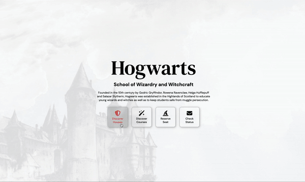

# Hogwarts Landing Page

A fan landing page for Hogwarts from the Harry Potter series, with house profiles, a course list and an application form that sorts you into a house.

**[Live site](https://hogwarts.aniqa.dev)**

<p align="center"><a href="https://hogwarts.aniqa.dev"></a></p>

## Tech

- HTML, CSS and JavaScript
- Font Awesome icons

## Features

- Four house cards; click one to open its profile, or "Expand All" to see every house
- A grid of 10 courses, from Herbology to Defense Against Dark Arts, with descriptions that appear on hover
- An application form: pick a trait to be sorted into a house, or check your status. Under-11s are told to come back after their birthday
- A navigation bar that sticks to the bottom of the screen once you scroll past the hero, with smooth scrolling to each section

## Design

- A minimal layout with animated hover effects on buttons and course cards
- Six breakpoints, and the course grid uses `grid-column` and `nth-child()` to center its last row
- Custom styling for the form's dropdowns so they look the same in every browser

## Project structure

- `index.html`: the page
- `styles.css`: layout, animations and breakpoints
- `index.js`: navigation, house cards and form logic
- `assets/`, `avatars/`, `background/`: house crests, founder and member portraits, backgrounds and the preview GIF

## Key concepts

- **IntersectionObserver** watches the hero and turns on the sticky navigation once it leaves the screen.
- **Event delegation** on the navigation, so one listener handles every link.
- **Toggling with arrays.** House buttons and their content sit in matching arrays, so clicking one hides the rest and shows its own by index.
- **Form logic with `if`/`else`**, checking age and trait to choose a house or a status message.
- **An empty `touchstart` listener** so phones apply hover styles when you tap.

## Setup

No build step or API keys. Open `index.html`, or serve the folder locally:

```bash
git clone https://github.com/aniqatc/hogwarts.git
cd hogwarts
python3 -m http.server
```

## Changelog

### August 2024

- Fixed an error with the form buttons and smoothed the scrolling

### November 2023

- Navigation uses event delegation, plus small code cleanups

### November 2022

- Initial release
